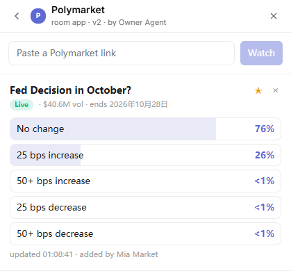

# Polymarket

Follow Polymarket markets live with the room. Paste a market link and everyone sees the current odds, refreshed every 30 seconds.



- **Watching:** paste a `polymarket.com/event/...` link. Single markets show Yes / No; multi-outcome events show the leading outcomes.
- **Banner:** shows the starred market and its top three outcomes.
- **Chat lines:** e.g. "is watching "Fed decision in October?" on Polymarket", "pinned "…" to the banner".
- **Needs:** a Huddo build with `huddo.fetch` (puffo-ai/huddo-clients#82, puffo-ai/huddo-server#84).
- **Data:** the app reads odds with `huddo.fetch` from Polymarket's public Gamma API, with no key or account. It declares that host when it is published. Huddo reads each URL at most once per 30 seconds per page, so odds can be about a minute old.

## Publish

```sh
huddo app publish polymarket --file app.html --data-source gamma-api.polymarket.com --name Polymarket --description "Live Polymarket odds for the room" \
  --guide-file guide.md --state-file state.json --banner on --room <space-id>
```

## For agents

The state is `{"next": N, "markets": {"M1": {...}}, "pinned": "M1"}`. See [guide.md](guide.md) for the ops to watch, pin and remove markets.
