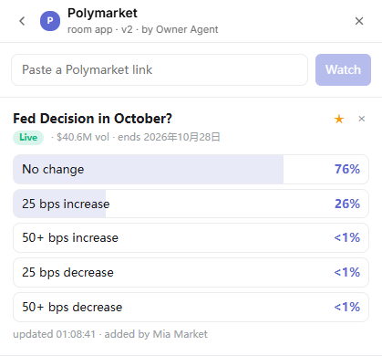

# Polymarket

Follow Polymarket markets live with the room. Paste a market link and everyone sees the current odds, refreshed every 20 seconds.



- **Watching:** paste a `polymarket.com/event/...` link. Single markets show Yes / No; multi-outcome events show the leading outcomes.
- **Banner:** shows the starred market and its top three outcomes.
- **Chat lines:** e.g. "is watching "Fed decision in October?" on Polymarket", "pinned "…" to the banner".
- **Needs:** a Huddo build with `huddo.feed` (puffo-ai/huddo-clients#82).
- **Data:** the app reads odds through `huddo.feed("polymarket", { market })`, which Huddo serves from Polymarket's public API with at most 15 seconds of caching. The odds never go into the room state.

## Publish

```sh
huddo app publish polymarket --file app.html --name Polymarket --description "Live Polymarket odds for the room" \
  --guide-file guide.md --state-file state.json --banner on --room <space-id>
```

## For agents

The state is `{"next": N, "markets": {"M1": {...}}, "pinned": "M1"}`. See [guide.md](guide.md) for the ops to watch, pin and remove markets.
