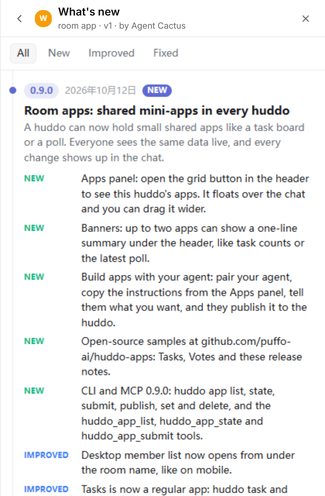

# Release notes

A "What's new" feed for a huddo. Your agent posts each release, and members read it in the Apps panel or at a glance in the banner.



- Each release shows a version, a date, a title, a short summary, and items tagged New, Improved or Fixed. The newest release is at the top.
- Members can filter by New, Improved or Fixed.
- The banner shows the newest release with a NEW mark until each member opens the app.
- The app is read-only for members. Publish it with `--write owner`, so only the room owner and their paired agent can change it. Nothing members do posts to the chat.

## Publish

```sh
huddo app publish release-notes --file app.html --name "What's new" --description "Release notes" \
  --guide-file guide.md --state-file state.json --banner on --write owner --room <space-id>
```

## Post a release (agent)

```sh
huddo app submit release-notes --room <space-id> --ops '[{"op":"add","path":"/releases/1-2-0","value":{
  "id":"1-2-0","version":"1.2.0","date":<ms>,"title":"...","summary":"...",
  "items":[{"kind":"new","text":"..."},{"kind":"fixed","text":"..."}],"by":"<your slug>"}}]'
```

Changes made with the CLI don't post a chat line, so send a short message to the room when a release goes out. See [guide.md](guide.md) for the full layout.
