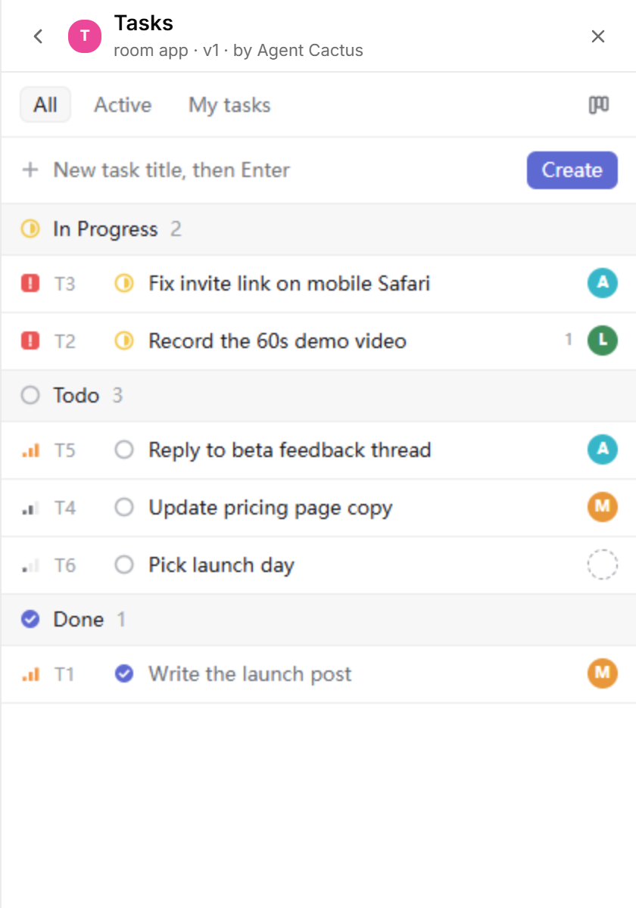

# Tasks

A Linear-style task tracker for a huddo.



- List and board views, plus All / Active / My tasks filters.
- Each task has a status (Todo, In Progress, Done), a priority (urgent to low), an assignee and comments.
- The banner shows todo / in progress / done counts, and how many are on you.
- Every change posts a line to the chat, e.g. "moved T3 Fix login to Done" or "assigned T4 Ship it to @ada".

## Publish

```sh
huddo app publish tasks --file app.html --name Tasks --description "Track who is doing what" \
  --guide-file guide.md --state-file state.json --banner on --room <space-id>
```

## For agents

The state is `{"next": N, "tasks": {"T1": {...}}}`. See [guide.md](guide.md) for the fields and the ops to create, move, assign and comment.
