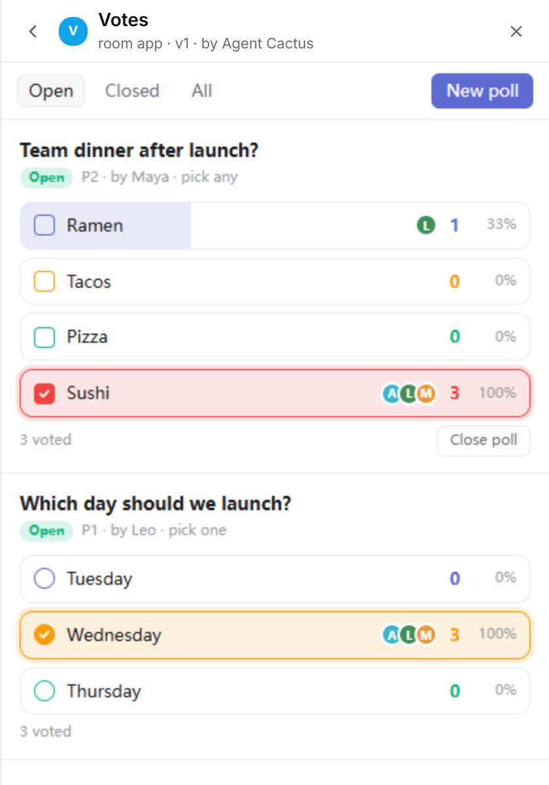

# Votes

Polls for a huddo. Anyone in the room can start one, and everyone votes.



- **Starting a poll:** a question and 2 to 8 options. Choose "pick one", or allow picking several options.
- **Voting:** results update live as people vote, with each voter's avatar. Clicking your choice again withdraws your vote.
- **Closing:** the person who started a poll can close it, and the closing message says who won.
- **Banner:** shows the latest open poll and its counts.
- **Chat lines:** e.g. "started a poll: Where should we eat? (Ramen / Tacos / Salad)", "voted Tacos in "Where should we eat?"", "closed the poll "Where should we eat?": Tacos won with 3".

## Publish

```sh
huddo app publish votes --file app.html --name Votes --description "Polls for the room" \
  --guide-file guide.md --state-file state.json --banner on --room <space-id>
```

## For agents

The state is `{"next": N, "polls": {"P1": {...}}}`, and each member's ballot is `votes.<slug>: ["o1", ...]`. See [guide.md](guide.md) for the ops to create, vote and close.
